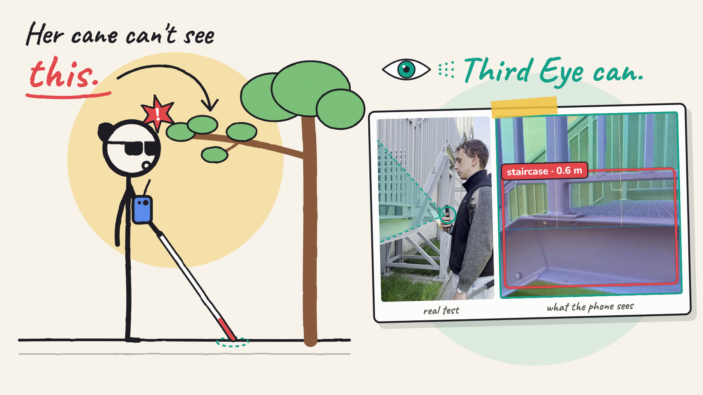
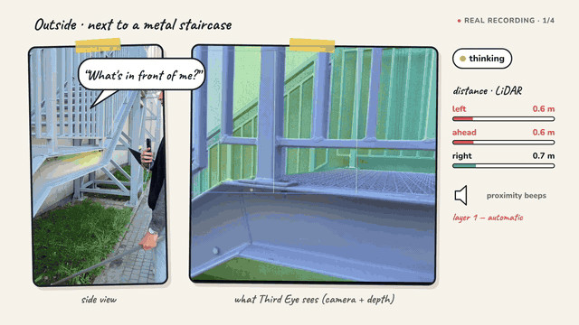
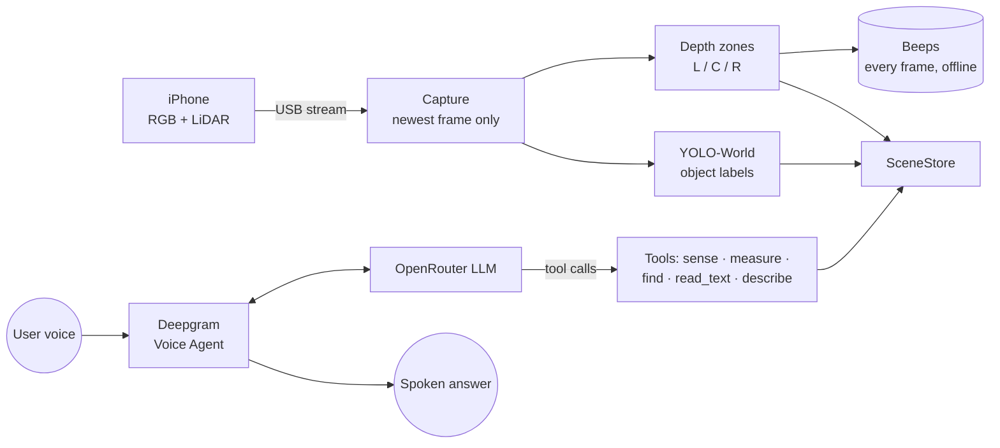

<div align="center">

# Third Eye

**An extra pair of eyes for white cane users: warns about obstacles at chest and head height, and answers questions about the surroundings by voice.**



<br>


</div>

> **AI informs. The user decides.** Third Eye never steers the user. It reports what is ahead, how far, and on which side, and leaves every decision to the person holding the cane.

---

## Demo

[](https://youtu.be/QlNLSiorAUE)

▶ **[Watch the full demo on YouTube](https://youtu.be/QlNLSiorAUE)** · 3:26

*A walkthrough of the problem, how Third Eye works, and real recordings from the prototype.*

---

## The problem

A white cane is excellent at what it was designed for: the ground in front of the user. Everything above waist height is invisible to it. Open truck tailgates, low branches, signposts, shelves and half-open windows are exactly the obstacles a cane sweeps underneath.

This is not a rare edge case. In a survey of **307 blind and visually impaired people** (Manduchi & Kurniawan, UC Santa Cruz [[1]](#sources)), **13%** reported a head-level accident at least once a month, and **23%** of those accidents required medical care.

Existing electronic aids do address it, but at a price: a dedicated smart cane such as the WeWALK Smart Cane 2 costs around **£849** [[2]](#sources), on top of a phone the user already owns.

## The solution

Third Eye turns a chest-worn iPhone with a LiDAR sensor into a hazard sensor and a voice assistant. It works in two layers that never interfere with each other:

| Layer | What the user gets | How it works |
|---|---|---|
| **1 · Always-on warnings** | Short beeps from the left, centre or right as soon as something is within reach above the cane, plus a separate alert for nearby cars. | LiDAR depth is split into left / centre / right zones from waist to head height and checked on **every frame**. Runs locally, with **no internet, no button and no LLM** in the loop. |
| **2 · Ask anything** | Hold a key and ask *"What's in front of me?"*, *"Where is the door?"*, *"How far is that person?"* or *"What does the sign say?"*, and get a short spoken answer. | A voice agent (Deepgram speech + an OpenRouter LLM) calls local sensor tools for real metres and sides instead of guessing. |

### What it can answer

- **Scene description**: what is ahead, answered for the user's actual question (vision LLM, with a perceptual-hash cache that skips redundant calls).
- **Distances**: metres to the nearest obstacle or to a named object, taken from LiDAR and never invented by the model.
- **Find an object**: a fresh, focused YOLO-World pass for a door, person, car or any other object, with side and distance. Weak detections are spoken as *"possibly…"*.
- **Read text**: signs, labels and route numbers via on-device Apple Vision OCR, reported verbatim.

## Why it matters

- **Covers the cane's blind spot.** Chest and head height is where the accidents above happen.
- **Hardware the user already has.** Sensing runs on a LiDAR-equipped iPhone instead of a dedicated device.
- **The safety-critical path stays offline.** Hazard beeps are computed locally on every frame and keep working when the network or the LLM does not.
- **Honest by design.** Every distance and side comes from sensor tools, and uncertain detections are labelled as uncertain.

## How it works



| Module | Responsibility |
|---|---|
| `assist/capture` | Record3D USB stream from the iPhone; always decodes the newest frame, so there is no lag |
| `assist/perception` | Depth zones and beep logic, YOLO-World detection, on-demand object finder, OCR, scene store |
| `assist/tools` | The sensor tools the agent can call |
| `assist/channel` | Deepgram Voice Agent session with push-to-talk |
| `assist/llm` | OpenRouter client for the agent and scene vision |
| `assist/agent` | Third Eye system prompt and voice configuration |

## Getting started

**You need:** an iPhone with LiDAR (Pro models) running the [Record3D](https://record3d.app/) app, a Mac with Apple Silicon, Python **3.11 or 3.12**, and `cmake`. Deepgram and OpenRouter API keys are only needed for the voice layer.

```bash
git clone https://github.com/<your-username>/third-eye.git
cd third-eye
brew install cmake
python3.11 -m venv .venv && source .venv/bin/activate
pip install -r requirements.txt
cp .env.example .env        # add DEEPGRAM_API_KEY and OPENROUTER_API_KEY
```

On the iPhone, open Record3D → **USB Streaming** → Record, connect it by cable and run:

```bash
python run_assist.py              # full experience
python run_assist.py --no-voice   # beeps + keyboard shortcuts only
python run_assist.py --no-yolo    # beeps only
```

**Controls:** hold `Space` to talk · `d` describe scene · `m` distances · `p` / `c` / `f` find person / car / door · `q` quit.

Configuration, logging and troubleshooting: [docs/DEVELOPMENT.md](docs/DEVELOPMENT.md).

### Tests

```bash
python -m pytest -q
```

## Roadmap

- Run fully on the iPhone, without the Mac and the cable
- A trigger on the cane handle instead of a keyboard key
- More languages for the voice layer (currently English)
- Field testing with cane users and orientation & mobility instructors

## Sources

1. R. Manduchi and S. Kurniawan, *Mobility-Related Accidents Experienced by People with Visual Impairment*, UC Santa Cruz technical report UCSC-SOE-10-24: [PDF](https://tr.soe.ucsc.edu/sites/default/files/technical-reports/UCSC-SOE-10-24.pdf). Source of the head-level accident statistics (survey of 307 people).
2. WeWALK Smart Cane 2 AI, RNIB Shop: [product page](https://shop.rnib.org.uk/products/wewalk-smart-cane-2-ai). Source of the smart cane price (£849) used as a reference point.

## Team

Built at **HackYeah 2026** in Kraków (Smart City track) by team **Beszketnyky**.

<!-- TODO: add team members and their GitHub profiles -->

## License

<!-- TODO: choose a license (e.g. MIT) and add a LICENSE file -->
Not licensed yet. All rights reserved by the authors.
# hackyeah-hackathon-beszketnyky
